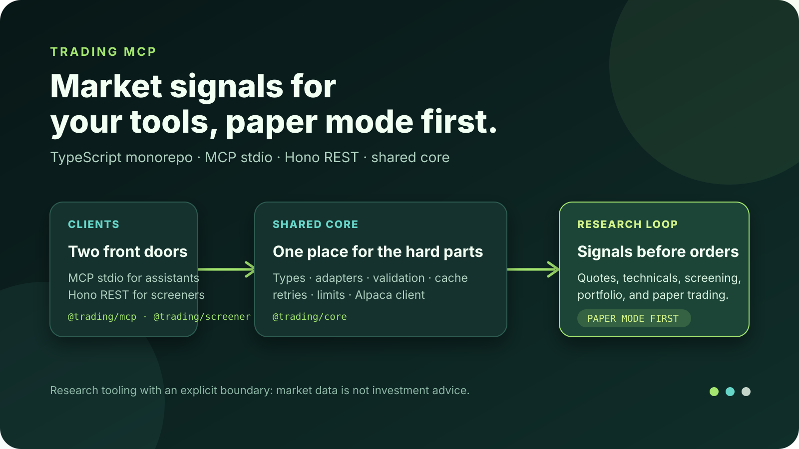

# Trading MCP · Market signals for your tools, paper mode first

[](https://github.com/aranlucas/trading-mcp/actions/workflows/ci.yml)

`trading-mcp` is a TypeScript workspace that exposes market and trading
capabilities through two clients: an MCP stdio server for AI assistants and a
Hono REST API for quotes, screening, and signals. A shared core normalizes
types, provider adapters, validation, caching, retries, rate limiting, and the
Alpaca trading client.

> **A safe research loop:** ask the MCP server for a quote or technicals, use
> the screener API to compare symbols, and inspect portfolio state with paper
> trading enabled. The same shared core keeps the clients consistent.

<p align="center">
  
</p>

This is engineering infrastructure and research tooling, not investment
advice. Market data can be delayed or unavailable, and order tools can reach a
real brokerage account when configured. Keep paper trading enabled until an
explicit, separately reviewed safety policy exists.

## Packages

- `@trading/core` — shared types, configuration, and Alpaca client.
- `@trading/mcp` — AI-assisted trading tools.
- `@trading/screener` — REST API for quotes, screening, and signals.

The MCP server includes market, portfolio, order, technical-indicator, options,
and screener tools. The REST app publishes `/api/health`,
`/api/openapi.json`, quote routes, and screener routes under `/api`.

## Run locally

```bash
pnpm install
pnpm build
```

Set `ALPACA_API_KEY`, `ALPACA_API_SECRET`, and optionally `ALPACA_PAPER=true` before using provider-backed features. Never commit credentials.

```bash
pnpm dev
pnpm dev:screener
```

`pnpm dev:screener` serves the screener at `https://screener.trading-mcp.localhost` through [Portless](https://github.com/vercel-labs/portless) (a dev dependency); its first run may ask for `sudo` to bind port 443 and trust a local certificate. The screener API serves `/api/health`, `/api/openapi.json`, quote routes, and screening routes. See [`ARCHITECTURE.md`](ARCHITECTURE.md) for deeper design notes.

### Technical analysis availability

MCP technicals and REST screening share `analyzeHistory` in `@trading/core`.
Unavailable indicators are `null`, never a synthetic zero: RSI14 needs 15
closes, SMA/EMA and Bollinger Bands need their period, and MACD(12,26,9) needs
34 closes to seed its nine-observation signal EMA. RSI retains the simple
trailing-14-change calculation; flat history returns a neutral 50.

`get_technicals` still requires 26 closes, so its SMA50, SMA200, and MACD can
be `null`. Consumers should check availability before comparing values.
Signals never use an unavailable indicator. Screening includes a symbol only
when every requested predicate can be evaluated and passes, including zero
numeric thresholds. Quote-only scans do not require history. Yahoo screening
requests allow calendar headroom and return up to the requested number of
ordered daily observations; newly listed or suspended symbols can return fewer.

## Configuration

Copy `.env.example` into your local environment. Alpaca credentials are needed
for portfolio, order, and Alpaca-backed screening features. The default
`SCREENER_PROVIDER=yahoo` keeps basic quote and daily-bar development keyless;
Polygon, Finnhub, and FRED keys enable additional provider features. Telegram
settings are only needed for the optional notification script.

| Variable                                             | Role                                                     |
| ---------------------------------------------------- | -------------------------------------------------------- |
| `ALPACA_API_KEY` / `ALPACA_API_SECRET`               | Alpaca account and trading API credentials.              |
| `ALPACA_PAPER`                                       | Defaults to paper mode unless explicitly set to `false`. |
| `SCREENER_PROVIDER`                                  | `yahoo` (default) or `alpaca` for screener data.         |
| `POLYGON_API_KEY`, `FINNHUB_API_KEY`, `FRED_API_KEY` | Optional provider access.                                |
| `PORT`                                               | Local screener port, default `3000`.                     |

## Architecture and source map

```mermaid
flowchart LR
  Agent[AI assistant] --> MCP[@trading/mcp<br/>MCP stdio]
  Client[API client] --> Screener[@trading/screener<br/>Hono REST]
  MCP --> Core[@trading/core]
  Screener --> Core
  Core --> Providers[Yahoo · Polygon · Finnhub · FRED · Finviz]
  Core --> Alpaca[Alpaca orders + portfolio]
```

- `packages/core/src/providers/` contains provider adapters and the unified
  market-data facade.
- `packages/core/src/lib/` contains timeout, retry, cache, rate-limit, log,
  error, and provider-metric helpers.
- `packages/core/src/schemas/` and `src/types/` are the shared contracts.
- `packages/mcp/src/server.ts` composes tool groups in `src/tools/`.
- `packages/screener/src/app.ts` mounts quote and screener routes and emits
  OpenAPI metadata.
- `api/` and `packages/screener/api/` are Vercel adapters for the REST app.

The current provider paths are intentionally documented in
[`ARCHITECTURE.md`](ARCHITECTURE.md), including known differences between MCP
and REST data sources and the roadmap for a single market-data facade.

## Deployment

Vercel uses Corepack to honor the root package's pinned `pnpm@12.10.1`
toolchain.

## Verify

```bash
pnpm install
pnpm build
pnpm typecheck
pnpm test
pnpm lint
pnpm secretlint
```

`pnpm test` builds the workspace, then runs the complete offline suite, including MCP tools and fixture-based
backtests. Live Yahoo backtests and deployment E2E are skipped by default.
Credentials, CI mode, or a deployment URL alone do not enable them.

To measure the core package's offline suite using its installed V8 provider:

```bash
pnpm --filter @trading/core exec vitest run --coverage --coverage.reporter=text-summary --coverage.reporter=json-summary --coverage.reportsDirectory=/tmp/trading-core-coverage-before
```

This report covers `packages/core/src/**/*.ts`, not the MCP or screener packages.
When evaluating redundant tests, repeat with a separate output directory after
the test edit and compare covered and total statement, branch, function, and line
counts. Keep the source scope and configuration unchanged, and retain assertions
for distinct behavior even when they hit the same lines. Source changes alter the
coverage denominator, so report covered and total counts alongside percentages;
those comparisons alone do not prove a removed test was redundant.

The core transport regressions run the installed Alpaca SDK against in-memory
responses and FRED against a fake `fetch`. They exercise pagination, numeric
normalization, order validation, and request failures without broker credentials
or real account/order operations:

```bash
pnpm --filter @trading/core exec vitest run test/alpaca.transport.test.ts test/fred.provider.test.ts
```

Alpaca history requests return at most `limit` recent bars in chronological order
(an integer from 1 to 10,000). The adapter sets a historical start and descending
request order, then uses the SDK's `maxPerSymbol` cap: the API's `limit` is only a
page size, and its default start otherwise restricts results to today. See the
[Alpaca historical-bars contract](https://docs.alpaca.markets/us/reference/stockbars).
Quotes use the latest two available daily bars and report unavailable data when
there are none; they are daily-bar snapshots, not real-time trade ticks. A failure
while fetching a required page rejects the whole history request.

Portfolio, position, and order normalization rejects malformed money/quantity
strings as provider errors rather than returning partial numbers or `NaN`.
Missing optional fields in those broker objects retain their existing fallbacks,
and valid fractional and signed amounts are preserved. Domain numbers still use
JavaScript floating point; these conversions do not provide exact decimal accounting.

Normalized quotes require a positive finite price and expose unavailable optional
fields as `null`. They include `source`, `kind`, provider observation `timestamp`,
and separate `retrievedAt`; a retrieval time does not make an old observation
current. Screening consumers handle unknown volume and change explicitly. See
[data contracts and migration guidance](docs/data-contracts.md) for the provider
matrix, public API boundaries, failure behavior, and offline regression checks.

`cancel_order` returns `{ orderId, status: "cancel_requested", message }` when
Alpaca accepts the request. This acknowledges the request; it does not establish
that the order is canceled or that exposure is gone. Query `get_order` for the
broker's current status: it can remain `pending_cancel`, become `filled`, or
become `canceled`. These broker status strings are preserved. A failed/ambiguous
request returns `isError: true` with `cancel_request_unconfirmed`, the order ID,
and a sanitized public error; check order state before retrying or replacing it.
The tool does not poll or place a replacement order. See the
[cancel endpoint](https://docs.alpaca.markets/us/reference/deleteorderbyorderid-1)
and [order lifecycle](https://docs.alpaca.markets/us/docs/orders-at-alpaca#order-lifecycle).

FRED omits missing or malformed observations, preserves real
zeroes, and returns unavailable results for non-success HTTP responses. Its latest
value is unavailable when the most recent observation is missing; it does not
substitute an older observation.

Run the Docker build-context integration tests separately with a running Docker daemon:

```bash
pnpm test:docker-context
# Native runner equivalent:
pnpm exec vitest run --config vitest.docker.config.ts
```

Vitest reports 15 host/private exclusions and five required inclusions using synthetic
files and Docker's own matcher (`FROM scratch`, no build networking, local export).
Fixture hooks remove temporary inputs and exports after success or failure. Docker
has a 120-second subprocess limit and a 4 MiB output limit; only this integration
config extends the hook budget to 130 seconds. The default offline unit command
does not discover these tests. CI runs this explicit command before building the
production image in its existing Docker step.

Only run these separate commands when you intentionally want external requests:

```bash
pnpm test:providers
VERCEL_DEPLOY_URL=https://your-preview.vercel.app pnpm test:deployment
```

`test:providers` opts into live Yahoo historical-data requests with
`RUN_REAL_PROVIDER_TESTS=1`. `test:deployment` opts into read-only requests to the
specified HTTPS Vercel preview with `RUN_DEPLOYMENT_E2E=1`; the URL is required.
These exact `1` flags also apply when invoking Vitest directly or running an
individual package. Do not set them in default CI. The original live test cases
are retained. Offline tests still cover provider mocks, order validation,
technical analysis, and captured historical fixtures without credentials.
Keep API secrets in the environment and inspect the paper/live mode before
exercising any order tool.

## Status

The monorepo is an active prototype with working MCP and REST surfaces and a
documented reliability/safety roadmap. It does not provide a trading UI,
guaranteed quotes, high-frequency execution, or a complete preview/commit
policy for live orders yet.

### Lint policy boundaries

The repository inherits Oxforge's recommended and Vitest presets, including all 18 anti-slop rules. Blanket local rule disables have been removed. Operational console output is allowed only for the methods used in the listed CLI, startup, and diagnostic-test files; MCP logs remain on stderr. Untrusted provider responses and JavaScript rejection values retain documented line-scoped parser/error-boundary exceptions rather than asserting fabricated types.

Existing non-null assertions remain temporarily allowed only in the explicitly listed backtest, technical-series, and integration-test files. That isolates the remaining type-safety work without rewriting financial calculations as part of a tooling cleanup. New files inherit the strict rule. Formatting, offline tests, package and test typechecks, secret scanning, and dependency policy checks remain required.
