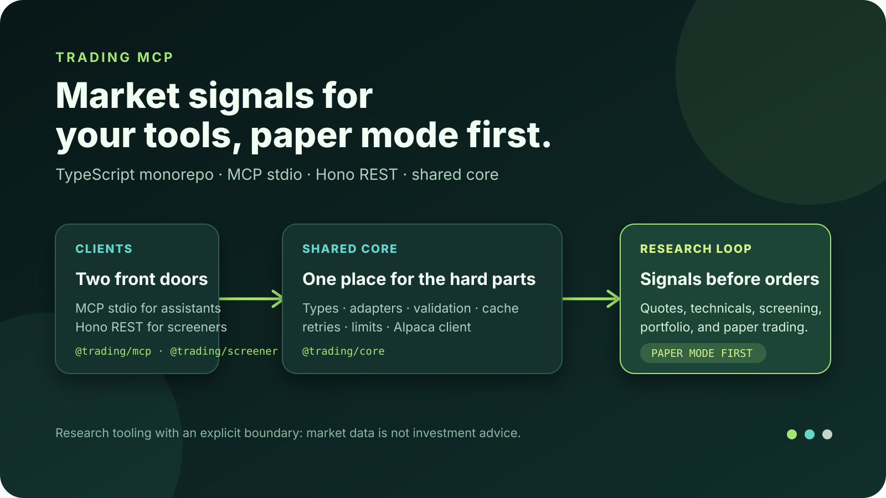

# Trading MCP

[](https://github.com/aranlucas/trading-mcp/actions/workflows/ci.yml)

Market research and trading tools through an MCP stdio server and a Hono REST
API, backed by a shared TypeScript core.

<p align="center">
  
</p>

This is research infrastructure, not investment advice. Data can be delayed or
unavailable. Order tools can reach a real brokerage account when configured;
keep paper trading enabled until an explicit, separately reviewed safety policy
exists. There is no preview/execute policy yet. Order submissions carry a
client order ID so an ambiguous result can be reconciled rather than replayed;
see [data contracts](docs/data-contracts.md#order-submission).

## Run locally

Use the Node version in [`.nvmrc`](.nvmrc) and the pnpm version pinned in
[`package.json`](package.json).

```bash
pnpm install --frozen-lockfile
pnpm build
```

Export the variables you need from [`.env.example`](.env.example) into the
process environment before starting a server; entrypoints do not load a `.env`
file automatically. Alpaca credentials are required for MCP quotes, technicals,
portfolio and orders, and for Alpaca-backed REST screening. `ALPACA_PAPER`
defaults to paper mode unless set to the exact string `false`. Keep credentials
out of source control.

REST screening defaults to keyless Yahoo data; set `SCREENER_PROVIDER=alpaca` to
use Alpaca. REST quote routes always use Yahoo. Polygon, Finnhub and FRED keys
unlock additional provider features. Telegram variables are only needed for
the optional notification script.

```bash
pnpm dev           # MCP stdio server
pnpm dev:screener  # REST server through Portless
```

The screener's development script uses [Portless](https://github.com/vercel-labs/portless)
with the name `screener.trading-mcp`. Startup reports the local URL; proxy and
TLS settings determine its scheme and port. For a direct local server after
building, run `pnpm --filter @trading/screener start` (default port `3000`,
overridden by `PORT`).

An MCP client can launch the built server with `node` and the absolute path to
`packages/mcp/dist/index.js`, supplying credentials in the child environment.
Keep stdout reserved for the MCP protocol; see the current logging limitation
in [architecture](ARCHITECTURE.md#runtime-boundaries).

## API and design

The REST app is mounted at `/api`:

- `/api/` is a status check with no external calls.
- `/api/health` probes providers over the network; it is not an offline liveness check.
- `/api/openapi.json` describes quote, screening and signal routes.

Read [data contracts](docs/data-contracts.md) before consuming quotes, indicators,
or cancellation responses. [Architecture](ARCHITECTURE.md) explains the differing
provider paths and engineering prerequisites. The [product roadmap](ROADMAP.md)
sets proposed research-workflow priorities and acceptance criteria.

## Verification

```bash
pnpm typecheck
pnpm test
pnpm lint
pnpm format:check
pnpm secretlint
pnpm syncpack:lint
```

`typecheck` and `test` build first because workspace imports resolve through
`@trading/core`'s `dist/`. Default tests use mocks and fixtures without broker
credentials or real account/order operations. For a focused core transport run
with dependencies installed:

```bash
pnpm --filter @trading/core exec vitest run test/alpaca.transport.test.ts test/fred.provider.test.ts
```

Only run these opt-in checks when external requests are intended:

```bash
pnpm exec tsx packages/screener/src/scripts/run-backtest.ts
VERCEL_DEPLOY_URL=https://your-preview.vercel.app pnpm test:deployment
```

The backtest script is exploratory and requests live Yahoo historical data.
`test:deployment` enables read-only requests to the supplied HTTPS preview with
`RUN_DEPLOYMENT_E2E=1`. Direct Vitest invocations require the same exact `1` flag;
credentials or a URL alone do not enable them. Keep this flag out of default CI.

The [Dockerfile](Dockerfile) builds the REST service. To build locally, use
`docker build -t trading-mcp:ci .`; `.dockerignore` excludes local credentials,
repository metadata and host build artifacts from the context.
